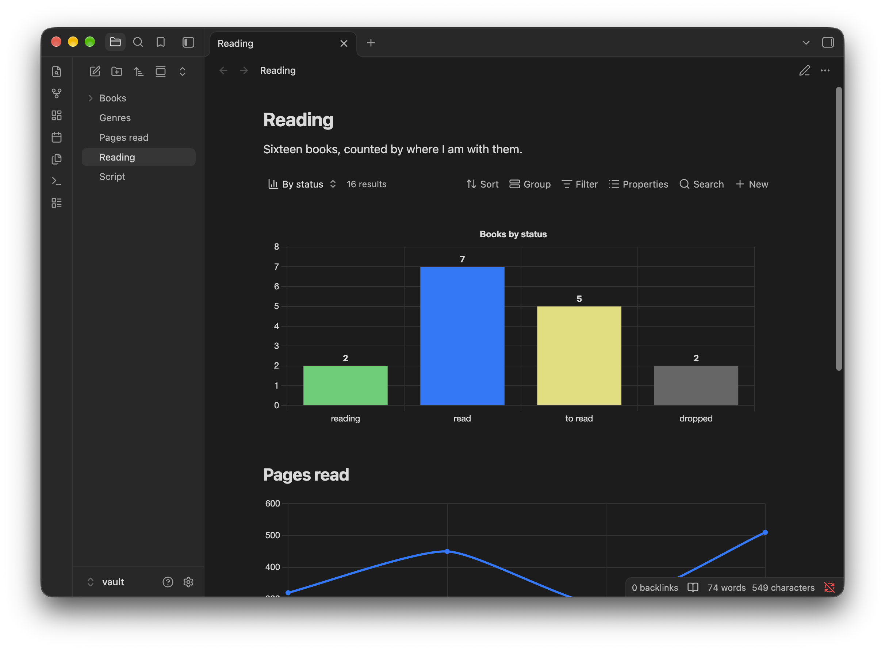

# Chartwork

Turn your notes into charts. Make one from a [Bases](https://help.obsidian.md/bases) view, a code block or a script. Charts match your theme, light or dark, with nothing to set up, and notes written for the [Charts](https://github.com/phibr0/obsidian-charts) plugin draw as they are.



## Three ways to make a chart

| Way | Use it when | Needs |
|---|---|---|
| [Bases view](https://github.com/polybjorn/obsidian-chartwork/blob/main/docs/bases-view.md) | the numbers are note properties, like books counted by status or hours summed by project | Bases, built into [Obsidian](https://obsidian.md) |
| [`chart` code block](https://github.com/polybjorn/obsidian-chartwork/blob/main/docs/code-block.md) | the numbers are in no note, so you type them in | nothing else |
| [Script function](https://github.com/polybjorn/obsidian-chartwork/blob/main/docs/script-api.md) | the numbers have to be worked out first, like notes created this month counted by tag | a plugin that runs JavaScript in notes, such as [Dataview](https://github.com/blacksmithgu/obsidian-dataview) |

The smallest chart is a code block:

````markdown
```chart
type: line
labels: [Jan, Feb, Mar, Apr]
series:
  - title: Pages read
    data: [320, 450, 280, 510]
```
````

Chartwork needs Obsidian 1.10.2 or later. [Chart.js](https://www.chartjs.org) 4 is bundled, so Bases views and code blocks need nothing else installed. The plugin is about 290 KB, almost all of it Chart.js and its sankey and annotation plugins.

## What Chartwork takes care of

- **Theme colours.** Text, grid lines and series follow your theme, light or dark, and redraw when you switch. In a Bases view or a script, any CSS colour sets a category apart, such as `var(--color-green)`.
- **Values on the bars** of a bar chart with one series.
- **Even horizontal bars.** The chart grows taller with each category, so bars keep one thickness.
- **Order and trimming.** In a Bases view or a script: sort by value or label, put chosen categories first, keep the largest few and add the rest up under one label.

## Coming from Charts

Your `chart` blocks and `renderChart` scripts draw as they are, with everything above on top, and the command **Check chart blocks and scripts** lists any that won't. While Charts is enabled, Chartwork leaves them to it. Charts' chart-builder menu and image export are left out.

## What the plugin accesses

- **Vault, read-only.** Chartwork sees only the data a Bases view, `chart` block or script hands it, and writes nothing. The check command reads your notes to find chart blocks and scripts. A Bases view's options are saved into its `.base` file by Bases itself.
- **No network.** The plugin makes no outbound requests.
