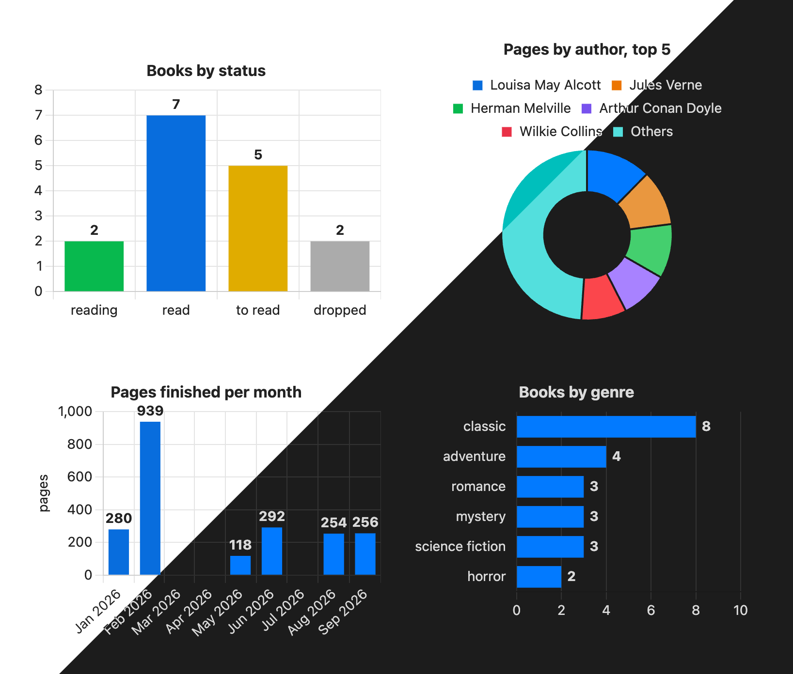
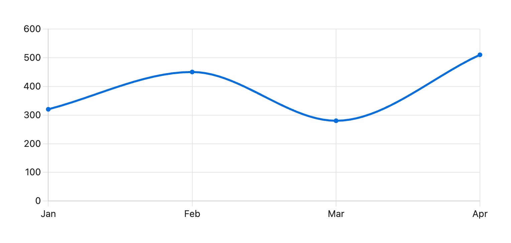
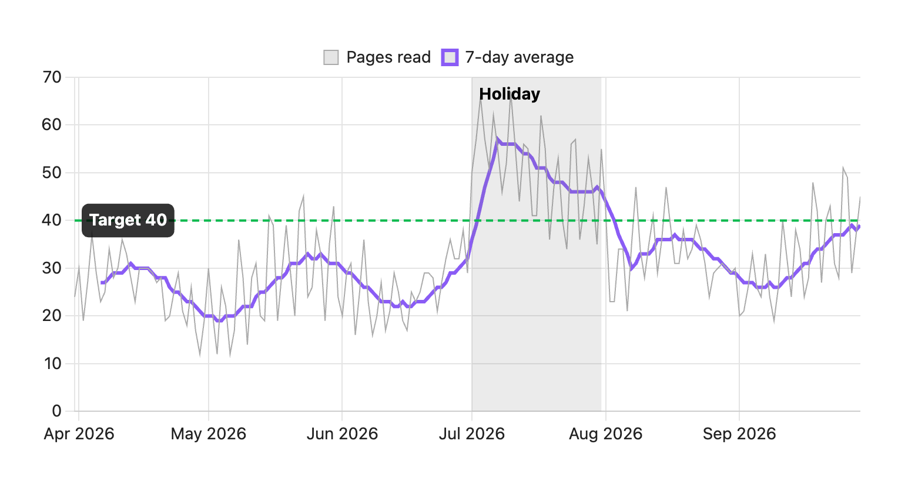

# Chartwork

One plugin for every chart in your vault. Make one from a [Bases](https://help.obsidian.md/bases) view, a code block or a script, and notes written for the [Charts](https://github.com/phibr0/obsidian-charts) plugin draw as they are.



- Matches your theme, light or dark. Color a category with `var(--color-green)`.
- Puts the value on each bar and keeps horizontal bars one thickness, however many there are.
- Plots dates from a Bases view by day, week, month or year, leaving a gap where nothing happened.
- Sorts by value, keeps the top few and adds up the rest as "Others".

## Three ways to make a chart

| Way | Use it when | Needs |
|---|---|---|
| [Bases view](https://github.com/polybjorn/obsidian-chartwork/blob/main/docs/bases-view.md) | the numbers are note properties, like books counted by status or hours summed by project | Bases, built into [Obsidian](https://obsidian.md) |
| [`chart` code block](https://github.com/polybjorn/obsidian-chartwork/blob/main/docs/code-block.md) | the numbers are in no note, so you type them in | nothing else |
| [Script function](https://github.com/polybjorn/obsidian-chartwork/blob/main/docs/script-api.md) | the numbers have to be worked out first, like notes created this month counted by tag | a plugin that runs JavaScript in notes, such as [Dataview](https://github.com/blacksmithgu/obsidian-dataview) |

Any Chart.js config: [Beyond the basics](https://github.com/polybjorn/obsidian-chartwork/blob/main/docs/advanced.md).

The smallest chart is a code block:

````markdown
```chart
type: line
labels: [Jan, Feb, Mar, Apr]
series:
  - title: Pages read
    data: [320, 450, 280, 510]
```
````



Chartwork needs Obsidian 1.10.2 or later. [Chart.js](https://www.chartjs.org) 4 is bundled, so Bases views and code blocks need nothing else installed. The plugin is about 290 KB, almost all of it Chart.js and its sankey and annotation plugins.

## A script, before and after

Notes created this month counted by tag, the top 10 as horizontal bars with the count on each, from `counts`, an object of tag and count. Charts' `renderChart` leaves the sorting, theme colors, counts on the bars and bar thickness to you. With Chartwork it is one call:

```js
window.chartwork.render(dv.container, {
  kind: "bar",
  horizontal: true,
  labels: Object.keys(counts),
  series: [{ name: "Notes", values: Object.values(counts) }],
  sort: "value",
  topN: 10,
}, dv.component);
```

<details>
<summary>The same chart with Charts' <code>renderChart</code>, 45 lines</summary>

```js
const top = Object.entries(counts).sort((a, b) => b[1] - a[1]).slice(0, 10);

// renderChart sets no colors, and Chart.js's grey disappears on a dark theme
const css = getComputedStyle(dv.container);
const text = css.getPropertyValue("--text-normal").trim();
const grid = css.getPropertyValue("--background-modifier-border").trim();
const bar = css.getPropertyValue("--interactive-accent").trim();

// Chart.js prints no values on bars by itself
const valueLabels = {
  id: "valueLabels",
  afterDatasetsDraw(chart) {
    const { ctx } = chart;
    ctx.save();
    ctx.font = "bold 12px sans-serif";
    ctx.fillStyle = text;
    ctx.textBaseline = "middle";
    chart.getDatasetMeta(0).data.forEach((el, i) => {
      ctx.fillText(chart.data.datasets[0].data[i], el.x + 6, el.y);
    });
    ctx.restore();
  },
};

window.renderChart({
  type: "bar",
  plugins: [valueLabels],
  data: {
    labels: top.map(([tag]) => tag),
    datasets: [{
      label: "Notes",
      data: top.map(([, n]) => n),
      backgroundColor: bar,
    }],
  },
  options: {
    indexAxis: "y",
    // Without this the bars get thinner as tags are added
    aspectRatio: 600 / (top.length * 28 + 60),
    layout: { padding: { right: 24 } },
    plugins: { legend: { display: false } },
    scales: {
      x: {
        beginAtZero: true,
        ticks: { color: text, precision: 0 },
        grid: { color: grid },
      },
      y: { ticks: { color: text }, grid: { display: false } },
    },
  },
}, dv.container);
```

</details>

## Beyond the basics

A script can also pass a full Chart.js config, with time axes, sankey diagrams and annotations built in. This one draws half a year of pages read per day, a 7-day average over it, a shaded holiday and a target line ([its script](https://github.com/polybjorn/obsidian-chartwork/blob/main/docs/demo-vault/Time%20series.md)):



More in [Beyond the basics](https://github.com/polybjorn/obsidian-chartwork/blob/main/docs/advanced.md).

## Switching from another chart plugin

Notes written for [Charts](https://github.com/phibr0/obsidian-charts) work without changes, so you no longer need Charts. The Bases view counts notes and adds up values by category or by day, week, month or year. That does the job of [Bases Charts](https://github.com/mProjectsCode/obsidian-bases-charts-plugin) and most of what people use [Tracker](https://github.com/pyrochlore/obsidian-tracker) for. Tracker's month calendar and streak summaries, and Charts' chart builder and image export, are not in Chartwork.

## What the plugin accesses

- **Vault, read-only.** Chartwork reads what a Bases view or script hands it, the note or CSV file a `chart` block names, and, for the check command, your notes. It writes nothing. A Bases view's options are saved into its `.base` file by Bases itself.
- **No network.** The plugin makes no outbound requests.
