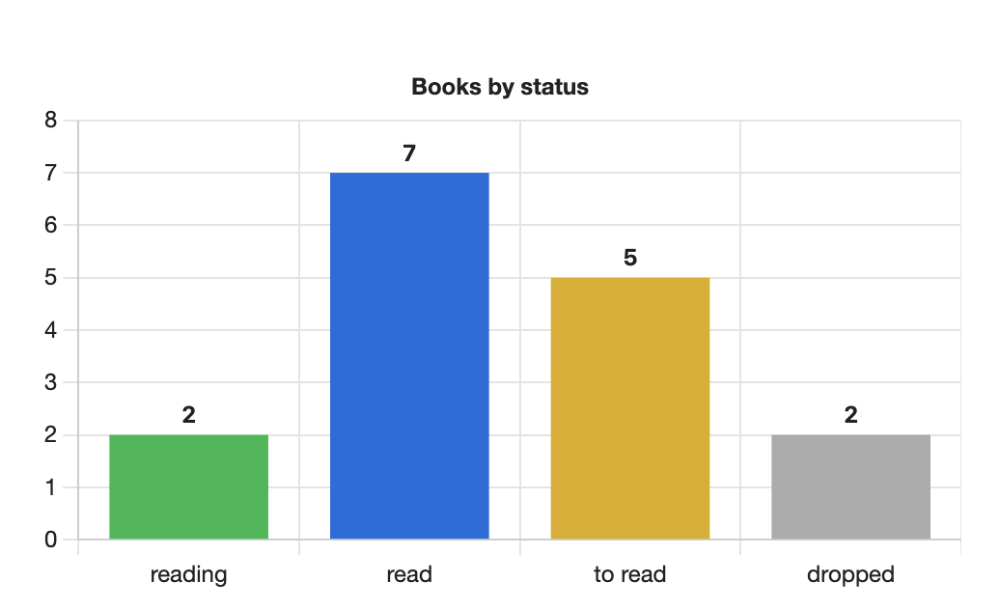
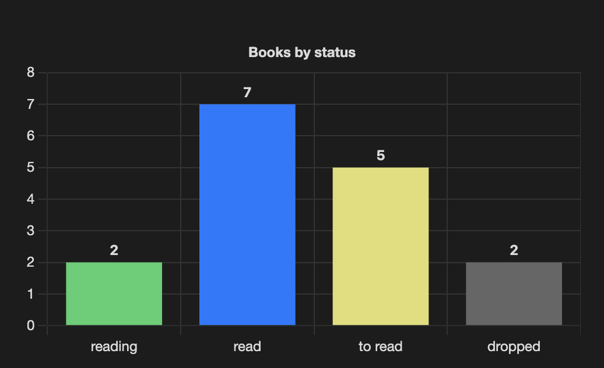

# Chartwork

Charts in Obsidian, made from your notes and drawn in your theme's colours, light or dark.

| Light theme | Dark theme |
|---|---|
|  |  |

> Not released yet; it runs my own vault.

There are three ways to make a chart.

**From note properties, in a Bases view.** Add a view to a base, pick **Chart** as its layout and choose the property to count by, like a book's `genre`. No code.


**From numbers you type in,** in a `chart` code block:

````markdown
```chart
type: line
labels: [Jan, Feb, Mar, Apr]
series:
  - title: Pages read
    data: [320, 450, 280, 510]
```
````


**From a script.** A script works out the numbers, and Chartwork draws them. This needs a plugin that runs JavaScript in notes, such as Dataview.

```js
window.chartwork.render(dv.container, {
  kind: "pie",
  labels: ["Read", "Reading", "To read"],
  series: [{ name: "Books", values: [7, 2, 5] }],
}, dv.component);
```


## Good to know

- Text, grid lines and colours follow your theme, and a chart redraws when you switch between light and dark.
- Bar charts print each value on its bar.
- Notes written for the Charts plugin keep working.
- Chartwork writes nothing to your vault and makes no network requests.

## Docs

- [Bases view](docs/bases-view.md): every option, including sorting, colours and keeping the largest few categories
- [Chart code block](docs/code-block.md): every key, and what differs from Charts
- [Script function](docs/script-api.md): everything `window.chartwork.render` takes
