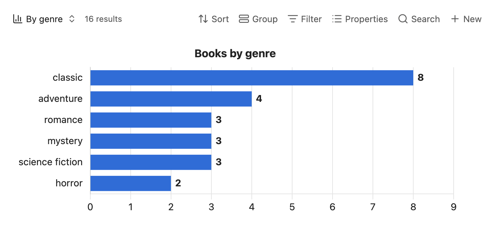

# Bases view

Chartwork adds a view type called **Chart** to Bases. Pick it from the view menu of any base, or of a `base` code block in a note, and set it up in the view's options. Each note in the base is one row; the chart counts the rows, or adds up a property, per category.



## Options

| Option | Key in the `.base` file | What it does |
|---|---|---|
| Category property | `x` | The property that names each bar or slice. A list property puts a note in every category it lists. Links show as the note name, tags without the `#`. A date property groups by date, see [Dates](#dates). |
| Aggregation | `aggregation` | `count` (the default) counts notes, `sum` adds up the value property, `average` averages it to one decimal more than its most precise value, `min` and `max` keep the smallest or largest. |
| Value property | `y` | The number to sum, average, or take the smallest or largest of. Hidden while counting. Text that reads as a number, like `"412"` or `3,5`, counts as one; anything else is skipped. |
| One series per property | `propertySeries` | Chart every property shown in the base's **Properties** menu, other than the category and the file name, as its own series, with the aggregation above. Count counts the notes that fill each one in. The value property is then hidden. |
| Chart type | `kind` | `bar`, `line`, `pie`, `doughnut` or `scatter`, see [Scatter](#scatter). |
| Point size property | `size` | Scatter only. A number property that sets each point's radius, see [Scatter](#scatter). |
| Group dates by | `dateUnit` | `day` (the default), `week`, `month` or `year`, when the category is a date. |
| Running total | `cumulative` | Bar and line charts: each series becomes its running sum, in the order drawn, after Sort and Largest categories to keep. On a time axis the total runs in date order. A category with no value adds nothing and leaves a gap. Pie and doughnut charts ignore it. |
| Horizontal bars | `horizontal` | Bars run sideways, and the chart grows taller with each category so bars keep the same thickness. |
| Title | `title` | Shown above the chart. |
| Minimum, Maximum | `yMin`, `yMax` | Range of the value axis, which is the horizontal one when bars run sideways. Empty fits the data. Not for pie and doughnut. |
| Start at zero | `beginAtZero` | On by default. Turn it off so a line such as weight over time fills the chart instead of hugging a zero axis. A minimum above zero still wins. |
| Average line | `average` | A dashed line at the mean of each series, in its color. |
| Line smoothing | `tension` | For line charts: 0 draws straight segments, higher values curve more. At the default, 0.2, the curve never dips below or rises above the values it joins; another value can overshoot a little between points. |
| Sort | `categorySort` | `none` keeps the order categories first appear in, `value` puts the largest first, `label` sorts by name. |
| Largest categories to keep | `topN` | Keep only this many categories, by value. 0 keeps all. |
| Label for the rest | `other` | With the option above, adds the dropped categories together under this label. Left empty, they are left out. |
| Order first | `categoryOrder` | Comma-separated labels to place first, in this order. The rest follow by Sort. |
| Category colors | `categoryColors` | One `label: color` line per category, for single-series bar, pie and doughnut charts. Any CSS color works, including `var(--color-green)`. |
| Skip empty categories | `skipEmpty` | Leave out notes with no category value. Otherwise they are counted under `(none)`, placed last. |

When the base is grouped, each group becomes its own series: one bar per group within each category, and a legend. With one series per property as well, each group and property pair is a series, named like `Gym: minutes`.

Bases keeps `sort` and `order` for its own settings, which is why Chartwork's are named `categorySort` and `categoryOrder`.

## Scatter

With Chart type set to `scatter`, each note is one point. The Category property (`x`) and the Value property (`y`) are both number properties: `x` is the horizontal position and `y` the vertical. Aggregation, Group dates by, One series per property, Horizontal bars and the category options do not apply and are hidden. A note missing either number, or with text that does not read as one, is left out.

Hovering a point shows the note's name and both values. A grouped base draws each group as its own series, with a legend.

The optional Point size property (`size`) sets each point's radius, scaled linearly from 3 px for the smallest value to 15 px for the largest, over the notes in the view. When every value is the same, points get a middle radius, and so does a note with no value for it.

```yaml
views:
  - type: chartwork-chart
    name: Sleep and mood
    kind: scatter
    x: hours_slept
    y: mood
    size: caffeine_mg
```

## Dates

When every category value is a date, a date and time, or a note named like `2026-03-02`, the notes are grouped by day, week, month or year. Weeks start on Monday. The time and time zone of a value are left out, so a run logged at 23:40 counts on its own day. Notes with no date are left out.

Bar and line charts then draw on a time axis: the categories run in date order, spaced by time, so a missing week shows as a gap rather than closing up. With count or sum, a period with no notes shows as 0; with average, min or max it has no point, and a line runs past it. Sort, Order first and Largest categories to keep do not apply on a time axis. Pie and doughnut slices are labeled `2026-03-02`, `2026-W10`, `2026-03` or `2026`.

If any category value is not a date, the property is charted as plain categories.

This counts daily notes per week, by their file names:

```yaml
views:
  - type: chartwork-chart
    name: Notes per week
    x: file.name
    dateUnit: week
```

## Mapping values to labels

The category is the property's value as it is. To rename values, merge some or leave others out, chart a formula instead. This one turns `consumed` into readable labels; the innermost `if` has no else, so any other value is empty, and Skip empty categories drops it:

```yaml
formulas:
  state: 'if(consumed == "active", "Reading", if(consumed == "yes", "Yes", if(consumed == "no", "No")))'
views:
  - type: chartwork-chart
    name: Reading status
    x: formula.state
    categoryOrder: Reading, Yes, No
    skipEmpty: true
    categoryColors:
      - "Reading: var(--color-green)"
```
