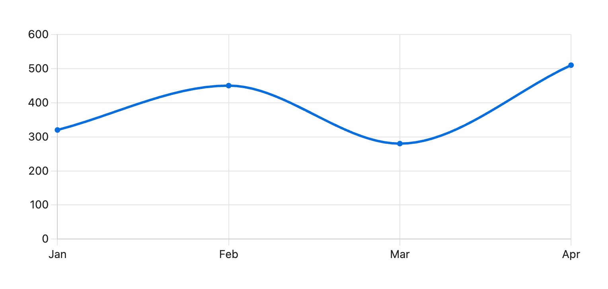

# Chart code block

For numbers that live in no note, type them into a `chart` code block. The format is the one the Charts plugin uses, so existing blocks draw without changes.

````markdown
```chart
type: line
labels: [Jan, Feb, Mar, Apr]
series:
  - title: Pages read
    data: [320, 450, 280, 510]
```
````



`type`, `labels` and `series` are required. Each series has a `title` and a `data` list with one value per label; `null` leaves a gap. A series also takes `hidden: true` to start switched off in the legend (bar, line, radar, scatter), `pointRadius: 0` to hide its dots (line, radar, scatter), and `stepped` to draw steps on a line (`true`, `after` or `middle`).

| Key | Applies to | What it does |
|---|---|---|
| `type` | all | `bar`, `line`, `pie`, `doughnut`, `radar`, `polarArea`, `scatter` or `sankey` |
| `title` | all | Shown above the chart. A title wider than the chart wraps onto more lines |
| `indexAxis: y` | bar, line | Horizontal bars |
| `stacked: true` | bar, line | Stack the series. The tooltip adds their total |
| `fill` | line, radar | `true` fills the area under each line, and with `stacked: true` each area down to the series below it. Radar shapes are filled unless `fill: false` |
| `tension` | line | Curve, 0 for straight segments. Left out, the line takes a gentle curve that never overshoots the values it joins |
| `spanGaps: true` | line, radar | Join the line across a missing value, or a blank table cell |
| `beginAtZero` | bar, line, radar | Start the value axis at zero. Default `true` |
| `xTitle` / `yTitle` | bar, line, scatter | Title for the value axis (`xTitle` when the bars are horizontal). A scatter takes both |
| `xMin`, `xMax`, `yMin`, `yMax` | bar, line, scatter | Axis range. `x` runs across and `y` up, as drawn; the label axis takes a label |
| `xReverse` / `yReverse` | bar, line, scatter | Run the axis the other way |
| `xDisplay` / `yDisplay` | bar, line, scatter | `false` hides the axis |
| `xTickDisplay` / `yTickDisplay` | bar, line, scatter | `false` hides the tick labels |
| `xTickPadding` / `yTickPadding` | bar, line, scatter | Pixels between the tick labels and the axis |
| `xLine` / `yLine` | bar, line | A dashed line across the chart at a value, or at a label on the label axis. Takes a list, like `yLine: [4, 6]` |
| `average: true` | bar, line | A dashed line at each series' average, in the series color. With `stacked: true` the line sits at the average of the stack up to that series, where the series is drawn |
| `time` | bar, line | `day`, `week`, `month` or `year`: the labels are dates such as `2026-03-02`, drawn on a date axis in steps of this unit, in date order. Works with `csv:` and table charts. Labels that are not all dates, or another unit, draw as categories with a line under the chart saying why |
| `cumulative: true` | bar, line | Draw each series as a running total, in label order and after any sorting. A missing value adds nothing and stays a gap. On a date axis the total follows date order |
| `bestFit: true` | line | A dashed straight trend line through the first series. Works with text labels and table charts |
| `bestFitNumber` | line | Which series the trend line follows, counting from 0 |
| `bestFitTitle` | line | Legend name of the trend line. Default `Line of Best Fit` |
| `rMin` / `rMax` | radar, polarArea | Scale range. With `rMax` set, a value above it is drawn up to the outer ring and no further |
| `labelColors: true` | bar | One color per label, as in a pie |
| `valueLabels` | bar, line, pie, doughnut, polarArea | `true` prints each value on its bar, slice or point. `false` hides them on a single-series bar chart, where they show by default. Values use the same number format as the axis ticks. A zero bar, a point outside the axis range and a stacked segment too short for its value get no label |
| `legend` | all | `false` hides the legend, `true` shows it |
| `legendPosition` | all | `top`, `bottom`, `left` or `right` |
| `height` | all but scatter and sankey | Chart height in pixels, like `400`. The chart keeps it while the width follows the pane. Wins over the height a horizontal bar chart grows to |
| `width` | all | Chart width, as CSS (`60%`) or pixels (`400`) |

Colors come from the theme, or from the list under Series colors in Chartwork's settings. A radar chart takes its spokes from `labels` and draws one shape per series. A `polarArea` chart draws one segment per label, sized by the first series. A bar chart with one series prints each value on its bar, and a horizontal one grows taller with each label so bars keep one thickness.

## Chart from a table

Put a block id on the line after a table, then name it with `id`. A link in a label shows its alias, its note name or its link text, not the markdown.

````markdown
|       | Q1 | Q2 | Q3 |
| ----- | -- | -- | -- |
| Books | 12 | 9  | 14 |
| Films | 4  | 7  | 5  |
^reading

```chart
type: bar
id: reading
layout: rows
```
````

| Key | What it does |
|---|---|
| `id` | The table's block id |
| `layout` | `rows`: each row is a series. `columns` (default): each column is a series |
| `select` | Rows or columns to draw, such as `[Books]`. Default all |
| `file` | The note holding the table, if not this one |
| `csv` | A CSV file to read instead, by vault path or file name, such as `csv: data/reading.csv` |

The first row and column hold the names. Lines without numbers are skipped. A CSV file may separate its fields with commas, semicolons or tabs, and its numbers may use a decimal comma. The chart redraws when the file changes.

A `sankey` block takes rows of `[from, flow, to]` in the first series, as Charts does, plus optional `priority`, `colorFrom` and `colorTo` maps from node name to a number or CSS color. Nodes without a color take the theme's.

A `scatter` block has no `labels`. Each series' `data` is a list of points, `{x: 160, y: 55}` as Charts writes them or `[160, 55]`.

## Differences from Charts

- Keys not listed above are ignored. Raw Chart.js options in the block have no effect; use [the script function](script-api.md) for those.
- A key neither Chartwork nor Charts knows, such as `valuelabels`, draws the chart with a line under it naming the key and, for a near miss, the key it may mean. So does one of Chartwork's own keys on a chart type that does not use it, such as `average` on a pie. A key Charts reads shows no such line, so a Charts note draws as it is.
- While Charts is enabled, Chartwork leaves `chart` blocks to it, and says so once. Disable Charts and reload to switch over.

Before removing Charts, run **Check chart blocks and scripts** from the command palette or Chartwork's settings, or press **Check notes first** on that notice. It lists every block Chartwork can't draw or draws without some of its keys, and every script that calls `renderChart`, with a link to each line.

A block with a mistake shows what is wrong in place of the chart, such as "Series 2 has a value that is not a number".
