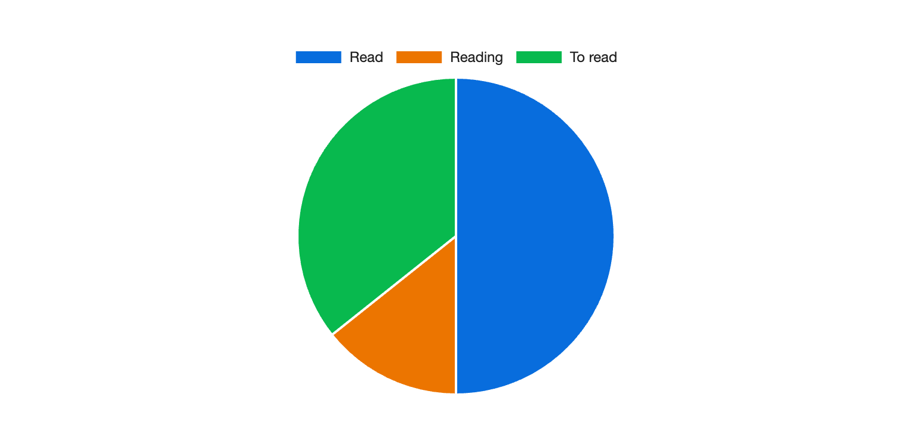
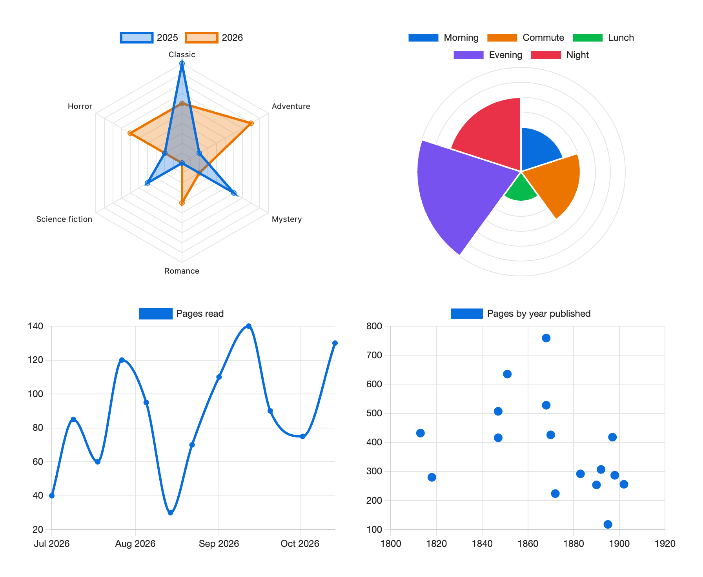

# Script function

Call `window.chartwork.render` from a plugin that runs JavaScript in notes, such as Dataview:

```js
window.chartwork.render(dv.container, {
  kind: "pie",
  labels: ["Read", "Reading", "To read"],
  series: [{ name: "Books", values: [7, 2, 5] }],
}, dv.component);
```



A script usually counts first, here this month's notes by tag:

```js
const counts = {};
for (const page of dv.pages().where((p) => p.file.ctime >= dv.date("som"))) {
  for (const tag of page.file.tags) counts[tag] = (counts[tag] ?? 0) + 1;
}
window.chartwork.render(dv.container, {
  kind: "bar",
  horizontal: true,
  labels: Object.keys(counts),
  series: [{ name: "Notes", values: Object.values(counts) }],
  sort: "value",
  topN: 10,
}, dv.component);
```

`render(element, spec, owner)` draws into `element` and returns a handle with `update(spec)` and `destroy()`. Pass the note's component as `owner` (`dv.component` in Dataview) so the chart goes when the note closes.

A bad or unknown field throws an error naming it, such as `chartwork: series[0].values has 3 entries but labels has 4`; `update` checks the same way. The spec is copied, so changing it afterwards does nothing.

`window.chartwork.version` tells a script which fields it can use.

## Spec

| Field | Type | What it does |
|---|---|---|
| `kind` | `"bar"`, `"line"`, `"pie"`, `"doughnut"`, `"radar"`, `"polarArea"` | Required. A radar takes its spokes from `labels` and draws one shape per series. A polar area draws one segment per label, sized by the first series |
| `labels` | string[] | Required. One per category |
| `series` | `{name, values, color?, fill?, stepped?, hidden?, pointRadius?}[]` | Required. `values` has one number or `null` per label. `color` is one color or one per label. `fill` fills the area under a line (with `stacked`, down to the series below); a radar is filled unless `fill` is `false`. `stepped` (`true`, `"after"`, `"middle"`) draws a line as steps, `hidden` starts a series switched off in the legend, and `pointRadius` sets the dot size, `0` for none |
| `title` | string | Shown above the chart |
| `horizontal` | boolean | Bars run sideways |
| `stacked` | boolean | Stack the series |
| `valueLabels` | boolean | Print each value on its bar, slice or line point. Default on for single-series bars. Formatted like the axis ticks; a zero bar, a point outside the axis range and a too-short stacked segment get none |
| `sort` | `"none"`, `"value"`, `"label"` | Category order. Default `"none"`, as given |
| `order` | string[] | Labels to place first; the rest follow by `sort` |
| `topN` | number | Keep the N largest categories by the first series |
| `other` | string | With `topN`, sums the dropped categories under this label |
| `categoryColors` | `{label: color}` | Color per category, for single-series bar, pie, doughnut and polar area charts |
| `labelColors` | boolean | Bars take one color per label |
| `valueTitle` | string | Title for the value axis |
| `beginAtZero` | boolean | Value axis or radar scale starts at zero. Default `true` |
| `tension` | number | Line curve from 0 to 1. Default 0.2 |
| `spanGaps` | boolean | A line or radar joins across a `null` value instead of leaving a gap |
| `legend` | boolean, `"top"`, `"bottom"`, `"left"`, `"right"` | Default shown for pie, doughnut, polar area and multi-series charts |
| `barThickness` | number | Pixels per bar on a horizontal chart. Default 28 |
| `referenceLines` | `{x?, y?}` | Bar and line charts: dashed lines across the chart at these values, or at labels on the label axis |
| `average` | boolean | Bar and line charts: a dashed line at each series' average, in the series color; stacked, at the height the series is drawn |
| `bestFit` | boolean | Line charts: a dashed straight trend line fitted to one series |
| `bestFitNumber` | number | Which series `bestFit` follows, counting from 0. Default 0 |
| `bestFitTitle` | string | Legend name of the trend line. Default `"Line of Best Fit"` |
| `axes` | `{x?, y?, r?}` | Per axis: `min`, `max`, `reverse`, `display`, `ticks` (`false` hides the tick labels) and `tickPadding`. `x` runs across and `y` up; `r` is the radar and polar area scale |

Colors can be any CSS color, including `var(--color-red)`. Without one, series take the colors listed under Series colors in Chartwork's settings, then `--chart-color-1`, `--chart-color-2` and on from a CSS snippet, else the theme's colors.

## Add-ons

Chartwork bundles no niche chart types, and fetches nothing. A script can add a Chart.js controller, element, scale or plugin from a CommonJS or UMD file in your vault, such as `chartjs-chart-matrix` or `chartjs-chart-financial` (candlestick), built for Chart.js 4. Run the block before any chart that uses the add-on. This one loads the matrix file saved as `Scripts/chartjs-chart-matrix.min.js`:

```js
const module = { exports: {} };
const src = await app.vault.adapter.read("Scripts/chartjs-chart-matrix.min.js");
new Function("module", "exports", "require", src)(module, module.exports, window.chartwork.require);
```

`chartwork.require` hands the file Chartwork's own `chart.js` and `chart.js/helpers`, and throws for any other name. Both add-ons above register themselves through it. For one that only exports its parts, call `window.chartwork.register(...items)`, which passes through to `Chart.register`. A chart that draws before this ran shows an error saying so; draw it again afterward. Registrations last until Chartwork unloads.

## Charts' `renderChart`

Scripts for the Charts plugin call `window.renderChart(config, element)` with a raw Chart.js config, or `{chartOptions: config, width: "60%"}`. Without Charts installed, Chartwork provides it: any Chart.js chart type, sankey and time axes included, with theme colors and square legend keys wherever the config sets none. A color the config does set can be `var(--color-red)` as well. A failing config shows its error and returns `null`. Annotations draw, in the text color unless they set their own. New scripts should use `render`, which knows when a note closes.


